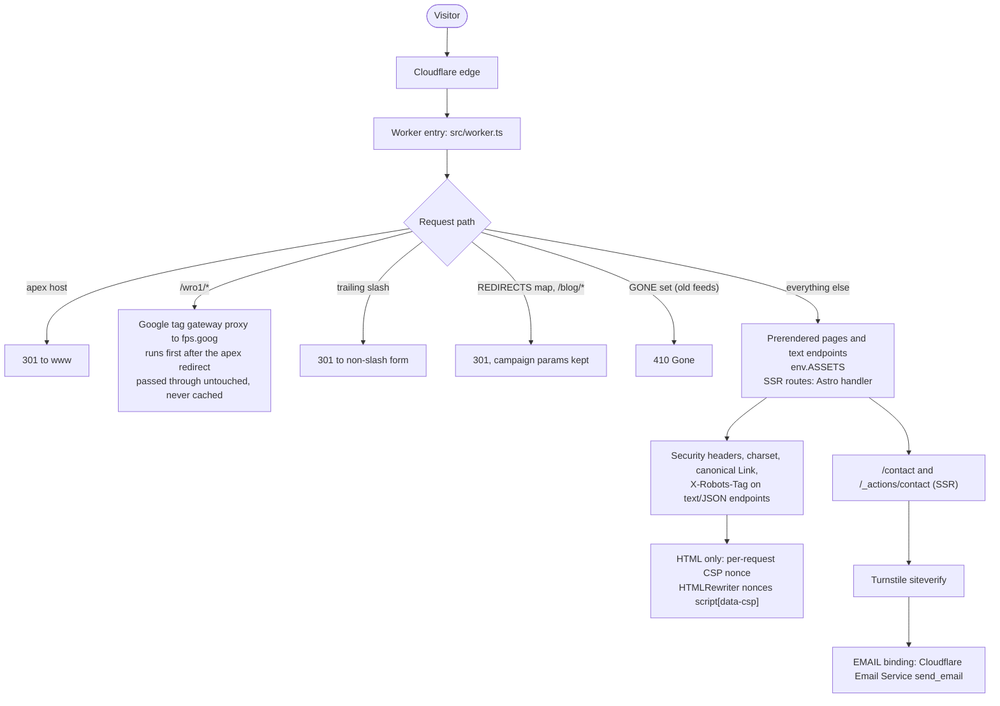
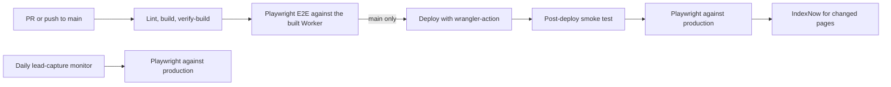

# Henrik Soderlund - Personal Website

[](https://github.com/henkisdabro/henriksoderlund-website-v2/actions/workflows/deploy.yml)
[](https://astro.build/)
[](https://workers.cloudflare.com/)

Professional portfolio site for Henrik Soderlund, an independent technology consultant based in Perth, Western Australia. Live at <https://www.henriksoderlund.com>.

Astro runs on Cloudflare Workers behind a custom Worker entry (`src/worker.ts`). Most pages are prerendered; the contact page and its Astro Action render on demand.

Copy on this site is Henrik's own. SEO, structure and formatting fixes are fine; ask before changing wording.

## Architecture



Bindings in `wrangler.json`: `EMAIL` (`send_email`) and the `TURNSTILE_SITE_KEY` var. The Astro Cloudflare adapter adds the `ASSETS` and `IMAGES` bindings at build time. `scripts/patch-wrangler.mjs` adds `run_worker_first` to the built config so the Worker sees prerendered pages too.

### CI/CD



Pull requests stop after the E2E step. The daily monitor is `.github/workflows/lead-capture-monitor.yml`.

## Stack

| Area | Used |
|------|------|
| Framework | Astro 7 (`output: 'server'`, pages opt into prerendering), `@astrojs/cloudflare` 14, `@astrojs/sitemap` |
| Runtime | Cloudflare Workers, Wrangler 4 |
| Language | TypeScript 6 |
| Contact form | Astro Actions with Zod validation, Cloudflare Turnstile, Cloudflare Email Service |
| Analytics | GTM served first-party via the `/wro1/*` tag gateway, Fou Analytics |
| Lint | Oxlint |
| Tests | Playwright (E2E and lead-capture suite) |
| Tooling | Node 24 (`.nvmrc`), pnpm 12 (pinned by `packageManager`) |
| Font | JetBrains Mono (self-hosted) |

## Pages

Navigation order, as in `src/components/NavigationBox.astro`:

| Route | Rendering | Content |
|-------|-----------|---------|
| `/` | Prerendered | Home |
| `/consultancy` | Prerendered | Services and case studies |
| `/builds` | Prerendered | Products, client builds, open source |
| `/perth-analytics-consultant` | Prerendered | Perth analytics landing page |
| `/expertise` | Prerendered | Skills and tooling |
| `/work-experience` | Prerendered | Experience and education |
| `/contact` | SSR | Contact form |

Not in the navigation: `/privacy` and `/404` (prerendered), `/health`, `/metrics` and `/.well-known/security.txt` (SSR).

Machine-readable endpoints, all prerendered plain text or markdown:

- `/llms.txt` and `/llms-full.txt` - site index and full content for LLMs
- Markdown twins of the main pages: `/index.html.md`, `/consultancy.md`, `/builds.md`, `/perth-analytics-consultant.md`, `/expertise.md`, `/work-experience.md`, `/contact.md`

## Local development

Requires Node 24 and pnpm (`corepack enable` provisions the pinned version).

```bash
pnpm install
pnpm run dev          # http://localhost:4321
pnpm run lint         # oxlint
pnpm run build        # depth-grain bundle, astro check, build, wrangler patch, nonce strip, verify-build
pnpm run test:e2e     # build, then Playwright against the built Worker
```

`pnpm run check` is the same script as `pnpm run build`; run one, not both. `pnpm run preview` does not work: the Cloudflare adapter does not support `astro preview` under `output: 'server'`. To test redirects, headers or CSP locally, read [docs/LOCAL-WORKER-TESTING.md](docs/LOCAL-WORKER-TESTING.md) first.

Server secrets (`TURNSTILE_SECRET_KEY`, `CONTACT_SYNTHETIC_TOKEN`) go in a local `.dev.vars`. Both must stay `optional: true` in `astro.config.mjs`; see [AGENTS.md](AGENTS.md).

## Deployment

Production deploys from GitHub Actions on push to `main`. Do not deploy by hand, and keep Cloudflare's own auto-build disabled. The CI build verification guards against the 0-byte-HTML failure described in AGENTS.md.

## Deeper docs

- [AGENTS.md](AGENTS.md) - architecture rules and traps (Worker edges, CSP, tag gateway, secrets)
- [docs/LOCAL-WORKER-TESTING.md](docs/LOCAL-WORKER-TESTING.md) - running the Worker locally
- [docs/CONTENT-AND-SEO.md](docs/CONTENT-AND-SEO.md) - structured data, Open Graph, sitemap, llms.txt
- [docs/DEPLOYMENT.md](docs/DEPLOYMENT.md) - CI workflow and Cloudflare setup
- [docs/LEAD-CAPTURE-TESTS.md](docs/LEAD-CAPTURE-TESTS.md) - contact form, CTA and dataLayer tests
- [docs/UTM-TAXONOMY.md](docs/UTM-TAXONOMY.md) - tagging inbound links
